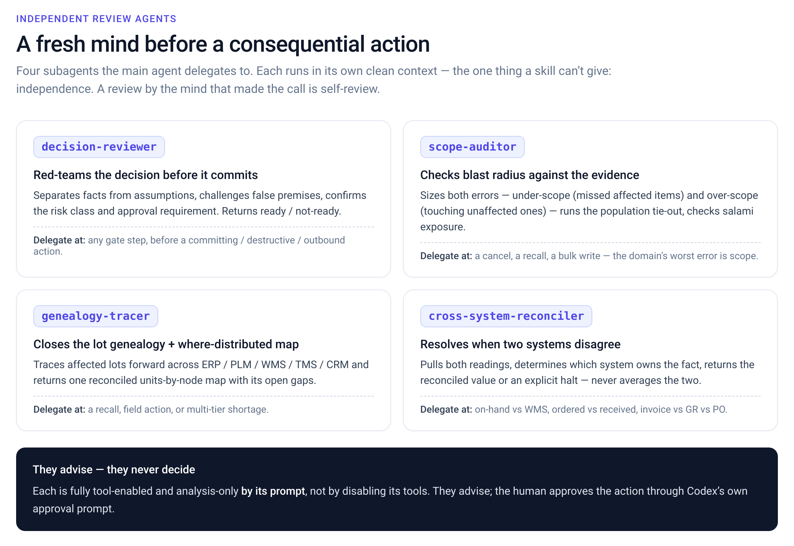

<p align="center">
  
</p>

# MetaFloor Supply Chain — an OpenAI (Codex CLI) plugin

Deep supply-chain operator expertise for OpenAI Codex, plus judgment for consequential actions. The
**expertise works day one with zero setup**: it gives Codex the judgment a seasoned operator carries
across **55 enterprise systems** and **16 end-to-end supply-chain workflows**. On top of that, a
**session-start safety layer** keeps the model classifying each connector action (read / write /
destructive / outbound) and **pausing consequential ones for human approval**.

This is **guidance, not enforcement.** The plugin owns no tools and no connectors, and it does not
police your tool calls — the actual approval of a connector action is handled by **Codex's own MCP
approval flow**. Think of this plugin as the operator judgment layer that sits on top of that. See
**[Safety, honestly](#safety-honestly)** below.

## Install
Requires **OpenAI Codex CLI**. The skills work with no dependencies.

```bash
# add this repo as a marketplace, then install the plugin
codex plugin marketplace add .
codex plugin add supply-chain@metafloor
codex plugin list                                 # -> supply-chain@metafloor  installed, enabled
```

Then ask it anything supply-chain — no connector needed:
```bash
codex exec "How does SAP handle a partial goods receipt on a PO?"
```

Remove: `codex plugin remove supply-chain && codex plugin marketplace remove metafloor`.

## What's inside
- **`skills/platforms/<category>/<vendor>/`** — 55 system-expertise skills across 15 categories (erp · planning · warehouse · transportation · oms · procurement · contracts · quality · mes · maintenance · customs · visibility · risk · plm · crm)
- **`skills/business-workflows/<name>/`** — 16 end-to-end decisions (reschedule, recall, shortage, 3-way match, …), each with the operating method, a worked example, and a failure→recovery playbook
- **`skills/gating/`** — the cross-cutting read / write / destructive / outbound judgment: how to classify an action and when to stop for a human
- **`agents/`** — 4 independent-review subagents (decision-reviewer, scope-auditor, genealogy-tracer, cross-system-reconciler) + `openai.yaml` interface
- **`hooks.json` + `scripts/session_context.sh`** — a SessionStart hook that injects the safety guidance so the model reasons in read/write/destructive terms from the first turn

## Independent review agents
Four subagents the main agent delegates to for a fresh, independent context before a consequential action (independence is the one thing a skill can't give). They advise; the human approves.



## Safety, honestly
The value of the safety layer here is **better operator judgment**, not a technical control that stops
a tool call. Being precise about what it is (and isn't):

- **What it does:** at session start it primes the model to classify every connector action and to
  **pause committing / destructive / outbound actions for explicit human approval**, with a clean
  before/after + rollback + provenance summary. That makes you materially less likely to fire a wrong
  or unauthorized write.
- **What it does *not* do:** it does **not** intercept or block your tool calls. On OpenAI Codex,
  `PreToolUse` hooks fire for the shell tool only — **MCP connector tool calls do not trigger a hook**,
  and only a `deny` decision has any effect. So a code-level "gate" over connector writes is **not
  possible as a plugin hook** on Codex today.
- **What actually gates a connector call:** **Codex's own MCP approval flow.** Configure it to match
  the posture you want — `approval_policy` (e.g. `on-request`) and per-connector `approval_mode` on your
  MCP servers. This plugin recommends a per-workflow posture (observe / suggest / gated / bounded-auto /
  auto); wire Codex's approval to enforce it.
- **`core/` and `eval/`** in this repo are a portable, unit-tested policy engine (action classification +
  an autonomy dial) kept for reference and reuse. They are **not wired as live enforcement** on Codex,
  for the reason above.

> A safety layer you can trust is one whose limits are stated. Do not treat this plugin as a guarantee
> that a bad connector action can't happen — treat it as expert judgment plus Codex's own approval.

## Requirements
The **skills work with no dependencies** — pure prose loaded by Codex. Python 3 is only needed if you
want to run the reference policy engine's tests under `eval/`.

## Quickstart
Day-one value needs no connectors and no config — just ask:
```bash
codex exec "How does SAP handle a partial goods receipt on a PO, and what breaks if I cancel the PO?"
codex exec "Operating in SAP: cancel all 10,000 units of PO-12831; ordered 10,000, received 4,000."
```
Reference policy-engine checks (optional, pure Python):
```bash
python3 -m unittest discover -s eval/tests -t .    # harness unit tests (stdlib, zero-dep)
python3 eval/lint_skills.py --strict               # skill + manifest consistency
```

## Building skills
Every expertise skill is prose-only — it teaches how one vendor system works and where it bites, and never
names a tool or invents an MCP op (the customer maps their real connectors). Every workflow ties to one real
supply-chain decision and adds the operating method (the computation with thresholds), a worked example with
real numbers, and a failure→recovery playbook. One vendor per skill; deep material spills to `references/`.

## License
MIT.
